<header class="top">
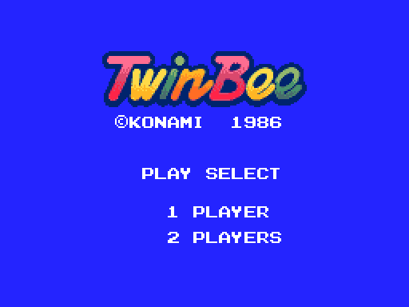
<h1>Twin Bee Enhanced (MSX2)</h1>
<p class="claim">El <b>Twin Bee</b> de Konami (1986), el cartucho de 32 KB de MSX, convertido en un juego mejorado para <b>MSX2</b>: el decorado se desplaza <b>pixel a pixel</b> sobre una pantalla de mapa de bits, las cinco fases y sus cinco jefes llevan <b>los graficos de Guantxip</b>, los sprites tienen <b>tres colores por linea</b> y la musica suena por el <b>SCC</b>, como en la Konami Game Collection.</p>
<p><a class="descarga" href="https://github.com/antxiko/TwinBee-Enhanced-MSX2-Patch/raw/main/ips/twinbee_enhanced_msx2.ips">Descarga el parche IPS</a></p>
<div class="ficha"><span>Konami &middot; 1986 &middot; RC-740</span><span>parche extraoficial</span><span><b>MSX2</b> + SCC</span><span>no se distribuye ninguna ROM</span><span><a href="https://github.com/antxiko/TwinBee-Enhanced-MSX2-Patch">El repositorio</a></span></div>
</header>

<div class="cifras"><div class="cifra"><b>140.977</b><span>bytes de IPS</span></div><div class="cifra"><b>5</b><span>fases redibujadas</span></div><div class="cifra"><b>5</b><span>jefes redibujados</span></div><div class="cifra"><b>256 KB</b><span>MegaROM con SCC</span></div><div class="cifra"><b>0</b><span>ROMs distribuidas</span></div></div>

## En imagenes

<div class="galeria">
<figure>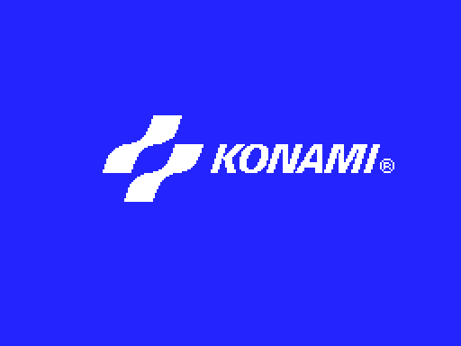<figcaption><b>El logo de Konami</b> con la doble ola, apareciendo como en <i>Salamander</i></figcaption></figure>
<figure><figcaption><b>El titulo</b>, con el logo nuevo</figcaption></figure>
<figure>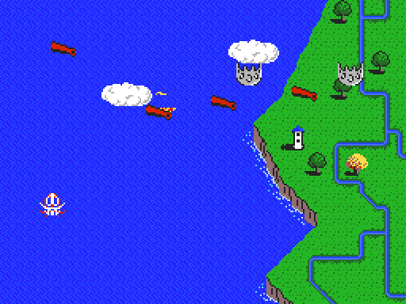<figcaption><b>La fase 1</b></figcaption></figure>
<figure>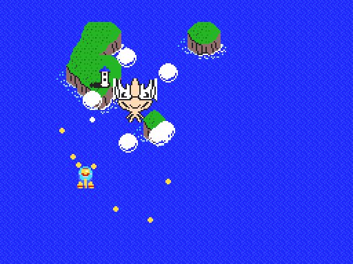<figcaption><b>El jefe de la fase 1</b></figcaption></figure>
<figure>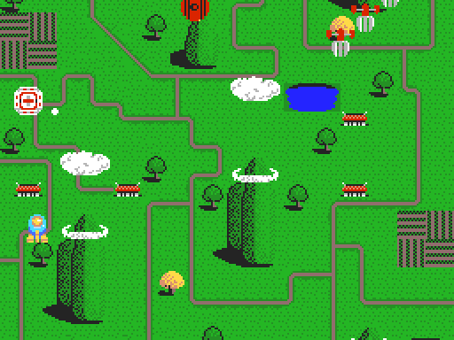<figcaption><b>La fase 2</b></figcaption></figure>
<figure>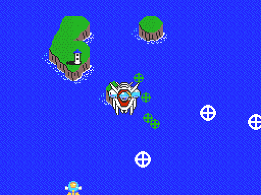<figcaption><b>El jefe de la fase 2</b></figcaption></figure>
<figure>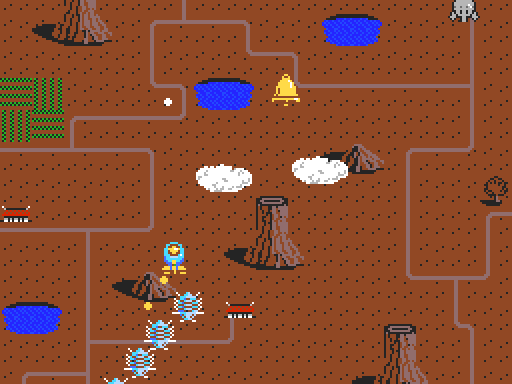<figcaption><b>La fase 3</b></figcaption></figure>
<figure>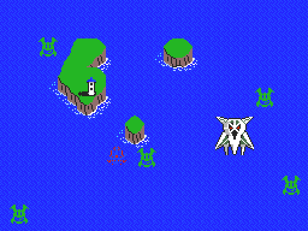<figcaption><b>El jefe de la fase 3</b></figcaption></figure>
<figure>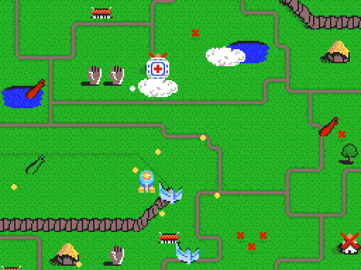<figcaption><b>La fase 4</b></figcaption></figure>
<figure>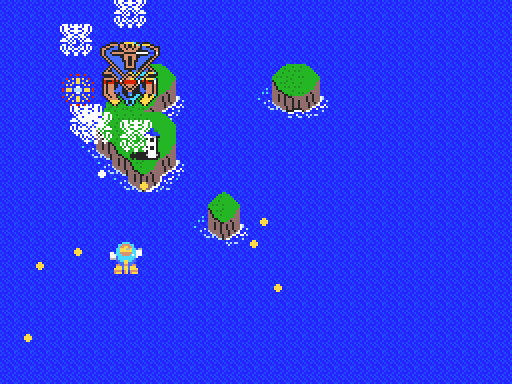<figcaption><b>El jefe de la fase 4</b></figcaption></figure>
<figure>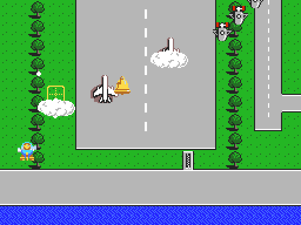<figcaption><b>La fase 5</b></figcaption></figure>
<figure>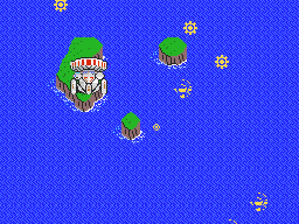<figcaption><b>El jefe de la fase 5</b></figcaption></figure>
<figure>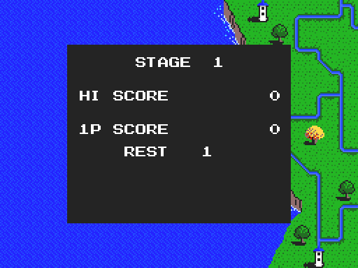<figcaption><b>La pausa</b> (F1), con el marcador</figcaption></figure>
<figure>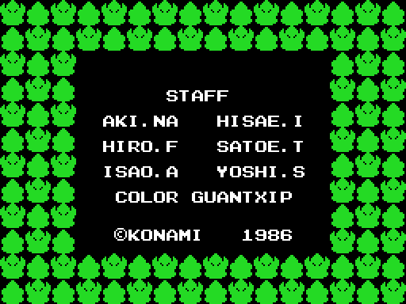<figcaption><b>Los creditos</b>, con los graficos</figcaption></figure>
</div>

## El parche

| | |
|---|---|
| el parche | `ips/twinbee_enhanced_msx2.ips`, 140.977 bytes |
| entrada | tu volcado de *Twin Bee*, 32.768 bytes, sha256 `02bdce8ceafe6af05a45b61a689e78807551df663afd152090f7cd9cac827dd4` |
| salida | una MegaROM de 256 KB, mapper Konami SCC, sha256 `a36c3fffc02a080bb341ed1fded4609107cc32d71db6a0875b95f0e551d40551` |
| hace falta | un MSX2 con 128 KB de VRAM y el SCC (un cartucho flash con SCC, como un MegaFlashROM SCC+ o un Carnivore2) |
| probado | en openMSX, con C-BIOS y con un Sony HB-F900: el juego entero, las cinco fases y sus jefes; **todavia no en un MSX real** |

## Que cambia

- **El decorado** es un mapa de bits de Screen 5 que el VDP desplaza linea a
  linea (registro 23), en lugar del desplazamiento por casillas de MSX1. Los
  mapas de las cinco fases son de Guantxip.
- **Los sprites**: naves, enemigos, campanas, nubes y jefes son dibujos de
  Guantxip, con dos sprites superpuestos para que cada linea tenga tres
  colores. TwinBee y WinBee son las mismas en todas las fases.
- **Los cinco jefes** llevan sus dibujos nuevos, con colores propios mientras
  estan en pantalla.
- **La musica** es la version SCC de la *Konami Game Collection Vol. 3*,
  dentro del propio cartucho.
- **La presentacion**: una intro, el logo nuevo del titulo y el logo de
  Konami de los juegos posteriores, el de la doble ola, apareciendo como en
  *Salamander*.
- **Los creditos** del final incluyen los graficos.
- **La pausa** (F1) muestra el marcador en un recuadro negro: la fase, el
  record, la puntuacion y las vidas que quedan.
- **Cuando mas de ocho sprites coinciden en una linea** se turnan
  parpadeando en vez de desaparecer, y las dos mitades de cada sprite de tres
  colores nunca se separan.

## Aplicarlo

Con cualquier herramienta de IPS (Lunar IPS, Floating IPS, RomPatcher.js)
sobre tu volcado, o directamente desde openMSX, que aplica parches IPS al
cargar el cartucho:

```
openmsx -machine C-BIOS_MSX2 -cart twinbee.rom -ips twinbee_enhanced_msx2.ips -romtype KonamiSCC
```

O con Python, que comprueba el resultado:

```
python3 tools/ips.py aplica twinbee.rom ips/twinbee_enhanced_msx2.ips twinbee_enhanced.rom
```

La ROM parcheada es una MegaROM Konami SCC: en un cartucho flash, elige ese
mapper si el cargador lo pregunta.

## Limitaciones conocidas

- Con el jefe en pantalla el juego baja a veces de 30 cuadros por segundo: el
  driver de musica SCC cuesta mucho mas que el reproductor PSG original.
- En los momentos mas cargados algun sprite parpadea o sale un instante con
  menos colores.
- Los objetos que quedan en el suelo (el arma, la estrella que limpia la
  pantalla y la vida extra) se ven con el dibujo del enemigo de tierra de la
  fase.
- Al cambiar de fase la pantalla se apaga medio segundo mientras se cargan los
  graficos nuevos.
- La partida a dos jugadores no esta probada.

## Creditos

- **Graficos**: Guantxip.
- **Port y programacion**: Antxiko (Compila!).
- **Pruebas**: Araubi.
- **El juego original y su musica**: Konami.

## Aviso

Extraoficial y gratuito. No se distribuye ni la ROM original ni la parcheada.
Lee el [aviso legal](https://github.com/antxiko/TwinBee-Enhanced-MSX2-Patch/blob/main/AVISO-LEGAL.md) antes de compartir el parche: ademas del
codigo y los graficos nuevos, lleva el driver de musica SCC de la *Konami Game
Collection Vol. 3*.
