<header class="top">
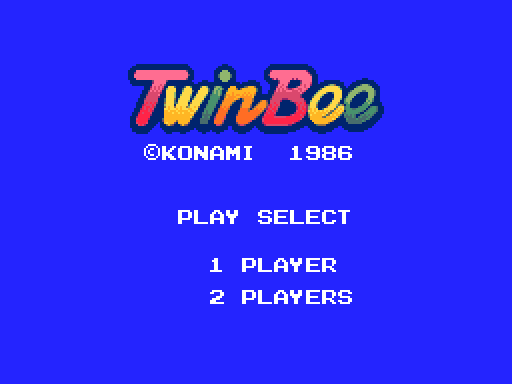
<h1>Twin Bee Enhanced (MSX2)</h1>
<p class="claim">Konami&rsquo;s <b>Twin Bee</b> (1986), the 32 KB MSX cartridge, turned into an enhanced <b>MSX2</b> game: the scenery scrolls <b>a pixel at a time</b> on a bitmap screen, the five stages and their five bosses wear <b>Guantxip&rsquo;s graphics</b>, the sprites show <b>three colours per line</b> and the music plays on the <b>SCC</b>, as in the Konami Game Collection.</p>
<p><a class="descarga" href="https://github.com/antxiko/TwinBee-Enhanced-MSX2-Patch/raw/main/ips/twinbee_enhanced_msx2.ips">Download the IPS patch</a></p>
<div class="ficha"><span>Konami &middot; 1986 &middot; RC-740</span><span>unofficial patch</span><span><b>MSX2</b> + SCC</span><span>no ROM distributed</span><span><a href="https://github.com/antxiko/TwinBee-Enhanced-MSX2-Patch">The repository</a></span></div>
</header>

<div class="cifras"><div class="cifra"><b>140,977</b><span>bytes of IPS</span></div><div class="cifra"><b>5</b><span>stages redrawn</span></div><div class="cifra"><b>5</b><span>bosses redrawn</span></div><div class="cifra"><b>256 KB</b><span>MegaROM with SCC</span></div><div class="cifra"><b>0</b><span>ROMs distributed</span></div></div>

## In pictures

<div class="galeria">
<figure><figcaption><b>The Konami logo</b> with its double wave, appearing as in <i>Salamander</i></figcaption></figure>
<figure><figcaption><b>The title</b>, with the new logo</figcaption></figure>
<figure>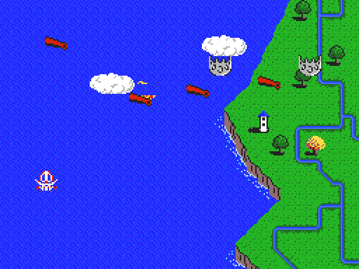<figcaption><b>Stage 1</b></figcaption></figure>
<figure>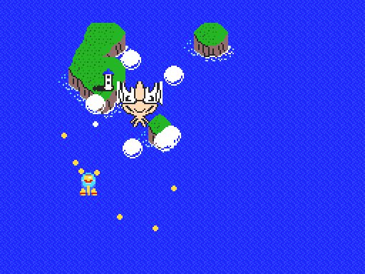<figcaption><b>The boss of stage 1</b></figcaption></figure>
<figure>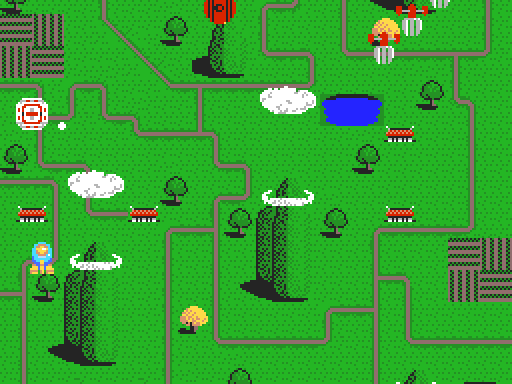<figcaption><b>Stage 2</b></figcaption></figure>
<figure>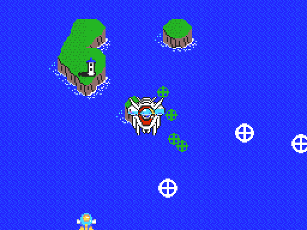<figcaption><b>The boss of stage 2</b></figcaption></figure>
<figure>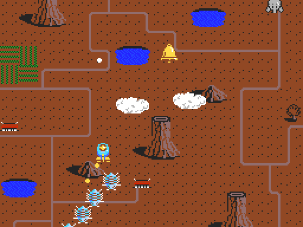<figcaption><b>Stage 3</b></figcaption></figure>
<figure>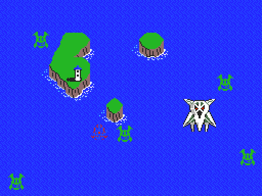<figcaption><b>The boss of stage 3</b></figcaption></figure>
<figure>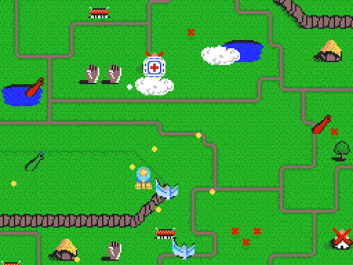<figcaption><b>Stage 4</b></figcaption></figure>
<figure>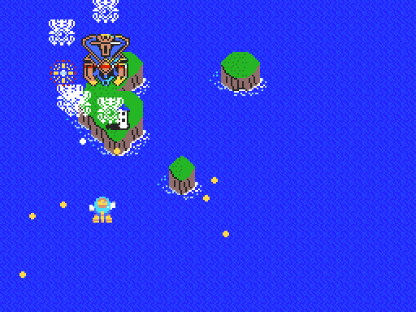<figcaption><b>The boss of stage 4</b></figcaption></figure>
<figure>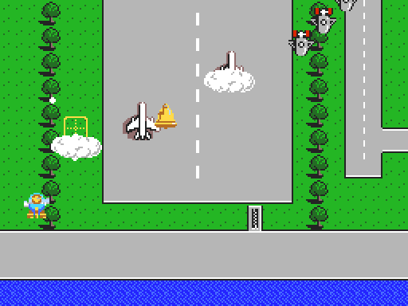<figcaption><b>Stage 5</b></figcaption></figure>
<figure>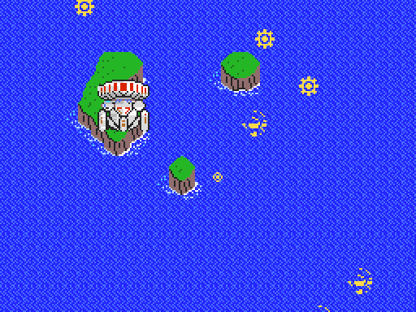<figcaption><b>The boss of stage 5</b></figcaption></figure>
<figure>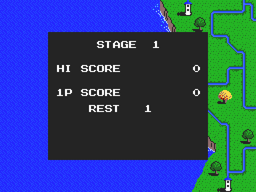<figcaption><b>The pause</b> (F1), with the scoreboard</figcaption></figure>
<figure>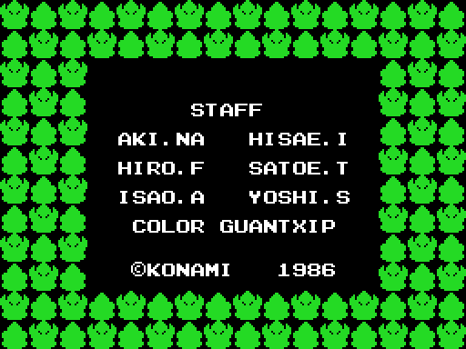<figcaption><b>The credits</b>, with the graphics</figcaption></figure>
</div>

## The patch

| | |
|---|---|
| the patch | `ips/twinbee_enhanced_msx2.ips`, 140,977 bytes |
| input | your *Twin Bee* dump, 32,768 bytes, sha256 `02bdce8ceafe6af05a45b61a689e78807551df663afd152090f7cd9cac827dd4` |
| output | a 256 KB MegaROM, Konami SCC mapper, sha256 `a36c3fffc02a080bb341ed1fded4609107cc32d71db6a0875b95f0e551d40551` |
| needs | an MSX2 with 128 KB of VRAM and the SCC (a flash cartridge with SCC, such as a MegaFlashROM SCC+ or a Carnivore2) |
| tested | in openMSX, with C-BIOS and with a Sony HB-F900: the whole game, the five stages and their bosses; **not yet on real hardware** |

## What changes

- **The scenery** is a Screen 5 bitmap that the VDP scrolls one line at a
  time (register 23), instead of the MSX1 tile scroll. The five stage maps
  are Guantxip's.
- **The sprites**: ships, enemies, bells, clouds and bosses are Guantxip's
  drawings, with two sprites laid on top of each other so that each line can
  show three colours. TwinBee and WinBee are the same in every stage.
- **The five bosses** have their new drawings, with their own colours while
  they are on screen.
- **The music** is the SCC version from the *Konami Game Collection Vol. 3*,
  inside the cartridge itself.
- **The presentation**: an intro, the new title logo and the Konami logo of
  the later games, with its double wave, appearing as it does in
  *Salamander*.
- **The credits** at the end of the game add the graphics.
- **The pause** (F1) shows the scoreboard in a black box: stage, high
  score, score and lives left.
- **When more than eight sprites share a line** they take turns
  flickering instead of vanishing, and the two halves of each three-colour
  sprite are never split.

## Applying it

With any IPS tool (Lunar IPS, Floating IPS, RomPatcher.js) on your own dump,
or straight from openMSX, which applies IPS patches when it loads the
cartridge:

```
openmsx -machine C-BIOS_MSX2 -cart twinbee.rom -ips twinbee_enhanced_msx2.ips -romtype KonamiSCC
```

Or with Python, which checks the result:

```
python3 tools/ips.py aplica twinbee.rom ips/twinbee_enhanced_msx2.ips twinbee_enhanced.rom
```

The patched ROM is a Konami SCC MegaROM: on a flash cartridge, pick that
mapper if the loader asks for it.

## Known limitations

- With the boss on screen the game sometimes drops below 30 frames per
  second: the SCC music driver costs much more than the original PSG player.
- In the busiest moments a few sprites flicker or briefly show fewer
  colours.
- The items left on the ground (the weapon, the star that clears the
  screen and the extra life) show the drawing of the stage's ground enemy.
- Changing stage blanks the screen for half a second while the new graphics
  are loaded.
- The two-player game has not been tested.

## Credits

- **Graphics**: Guantxip.
- **Port and programming**: Antxiko (Compila!).
- **Testing**: Araubi.
- **The original game and its music**: Konami.

## Notice

Unofficial and free. Neither the original ROM nor the patched one is
distributed. Read the [legal notice](https://github.com/antxiko/TwinBee-Enhanced-MSX2-Patch/blob/main/LEGAL-NOTICE.md) before sharing the
patch: besides the new code and graphics, it carries the SCC music driver of
the *Konami Game Collection Vol. 3*.
